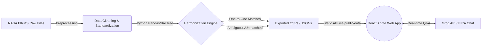

<div align="center">

# 🔥 FireFusion AI

**Two satellites see fire differently. FireFusion AI shows how they differ, where they agree, and what it means.**

[](#)
[-FF0000?style=for-the-badge)](#)
[](#)
[](#)
[](#)

*Challenge: Harmonization of MODIS and VIIRS Hot Spots*

### 🚀 [Explore the Live Data Demo](https://hr-pyro-vanta-72yy.vercel.app/)

<br>
</div>

<details open>
  <summary><b>📋 Table of Contents</b></summary>
  
  - [📖 What is FireFusion AI?](#-what-is-firefusion-ai)
  - [📊 Headline Results](#-headline-results)
  - [✨ Key Features](#-key-features)
  - [⚙️ Architecture & Data Flow](#️-architecture--data-flow)
  - [🚀 The Future](#-the-future)
  - [💻 Getting Started](#-getting-started)
  - [👥 Team HR Pyrovanta](#-team-hr-pyrovanta-786)
</details>

---

## 📖 What is FireFusion AI?

Responders often get conflicting maps from different satellites. **FireFusion AI** is a web application that harmonizes NASA **MODIS** and **VIIRS** active-fire detections into one explorable, unified map. We solve the confusion by clearly showing which detections are the same fire and which are not.

> 💡 **Core Philosophy:** We do *not* claim to count real-world fires. We illustrate how the two sensors agree and differ, preserving every original observation without forcing false certainty.

### 📍 Selected Regions & Datasets (California, USA)
Users can instantly switch between three distinct datasets directly from the UI:
- 📅 **2023 Season:** 1 July – 30 September 2023 *(Featured case study)*
- 📅 **2026 Season:** Recent historical archive integration
- 🔴 **LIVE Mode:** The last 5 days of real-time FIRMS data

---

## 📊 Headline Results

*Comparing the 2023 vs 2026 California Fire Seasons based on real NASA FIRMS Data.*

| Metric | 2023 Season | 2026 Season |
| :--- | :--- | :--- |
| **Total Records** | **39,899** (MODIS: 3,721 \| VIIRS: 36,178) | **33,027** Records |
| **Confirmed Matches** | **98** (One-to-one matched pairs) | **64** Matched pairs |
| **Ambiguous Groups** | **954** candidate groups | - |
| **Unmatched Records**| **23,559** detections | - |
| **Busiest Day** | 19 August 2023 *(2,111 detections)* | - |

---

## ✨ Key Features

* 🗺️ **Guided Tour & Interactive Map:** A guided tour walks first-time users through the platform. The map lets you toggle layers by sensor and matching status. Click any dot to inspect its sensor, FRP, confidence, and match status.
* 📈 **Dashboard & Explainers:** View detection counts instantly. Includes a **"Why is the match rate only 2.6%?" Explainer** button on the Match Coverage KPI that breaks down the scientific reasons in plain English.
* 🗓️ **Activity Calendar:** Track daily MODIS and VIIRS activity with anomaly outlines. 
* 🧪 **Comparison Lab & Anomalies:** Test sensitivity to distance and time windows across satellite pairs. Includes an **Anomaly Explainer** that lists flagged days—clicking any specific day instantly jumps the map to that date.
* 🤖 **Ask FireFusion AI (FIRA):** FIRA is a data-grounded storyteller. Now upgraded with a **Groq-powered chat panel** embedded in the app that answers questions directly from your real data. It never invents causes or impacts.
* 📥 **Export Ready:** Downloadable harmonized datasets directly from the UI.

---

## ⚙️ Architecture & Data Flow

FireFusion AI is built for speed and reliability. There is **zero backend required** for the historical data viewer, ensuring rapid load times and full offline capability for cached datasets.



<details>
<summary><b>📐 Click to view Strict Matching Rules & Sensitivities</b></summary>
<br>

| Rule Parameter | Threshold |
| :--- | :--- |
| **Distance** | 1.0 km or less *(Haversine, BallTree)* |
| **Time** | 4 hours or less difference *(UTC)* |
| **Confirmed Match** | Exactly **one-to-one** only |
| **Ambiguous Match** | Multiple possible partners. *Honesty over false certainty: a match is never forced.* |

> *Anomaly flags use a robust z-score (median and MAD of daily counts per sensor) above 3.5. These are statistical deviations from the three-month window, not predictive forecasts.*
</details>

---

## 🚀 The Future

From California to the world: our method works for any region or sensor pair. 
**Next Step:** Mapping **Pakistan's own fire seasons** using this exact harmonization methodology to provide faster, trusted fire maps for local responders, moving towards near-real-time alerts.

---

## 💻 Getting Started

### Local Deployment
Ensure you have `Node.js` installed.

```bash
# 1. Navigate to frontend directory
cd frontend

# 2. Install dependencies
npm install

# 3. Start development server
npm run dev          

# 4. Build for production (Optional)
npm run build        
npm run preview      # Serve the production build locally
```
> ⚠️ **Note:** The Groq API key is required in your `.env` file for the "Ask FireFusion AI" real-time chat feature to function.

<details>
<summary><b>⚠️ View Limitations & Disclaimers</b></summary>
<br>

- **Not Ground Truth:** Satellite detections are not ground-confirmed fires. A missing detection does not guarantee the absence of fire (affected by clouds, smoke, etc.).
- **Metrics:** FRP is compared *between* sensors, never summed across them. Hotspots do not measure total burned area.
- **Non-Predictive:** The anomaly baseline spans three months, not long-term climatology. This is **not** an early-warning predictive system.
</details>

---

## 📜 Data Attribution

- **Fire Data:** [NASA FIRMS](https://firms.modaps.eosdis.nasa.gov/) (Fire Information for Resource Management System): MODIS Collection 6.1 and VIIRS 375 m active-fire data (NOAA-20 and Suomi NPP). *Without FIRMS open data, there is no project.*
- **Satellite Basemap:** Esri World Imagery (Esri, Maxar, Earthstar Geographics).

---

## 👥 Team HR Pyrovanta (#786)

| Name | Role | Responsibilities |
| :--- | :--- | :--- |
| **[Hina Ramzan](https://www.linkedin.com/in/hina-ramzan/)** | 👑 Team Leader | Integration, deployment, README, demo video, submission |
| **[Muhammad Ihsan](https://www.linkedin.com/in/muhammad-ihsan-445350320/)** | 💾 Data Engineer | Data download, readiness gate, audit, provenance, exports, FIRA narration |
| **[Hasnain Ahmad](https://www.linkedin.com/in/hasnain-ahmad-047210349/)** | 🔬 Science Lead | Harmonization, sensitivity analysis, FRP correlation, anomaly detection, tests |
| **[Sharjeel Sarwar](https://www.linkedin.com/in/sharjeel-sarwar-a18414327/)** | 💻 Frontend Developer | App shell, dashboard, map, calendar, comparison lab, FIRA panel, downloads |
| **[Zukhraf Maryam](https://www.linkedin.com/in/zukhraf-maryam-275321293/)** | 🎨 Presentation | Slide deck creation, visual storytelling, pitch preparation, formatting |

<div align="center">
  <br>
  <i>Built for the NASA Space Apps Challenge 2026 </i>
</div>
